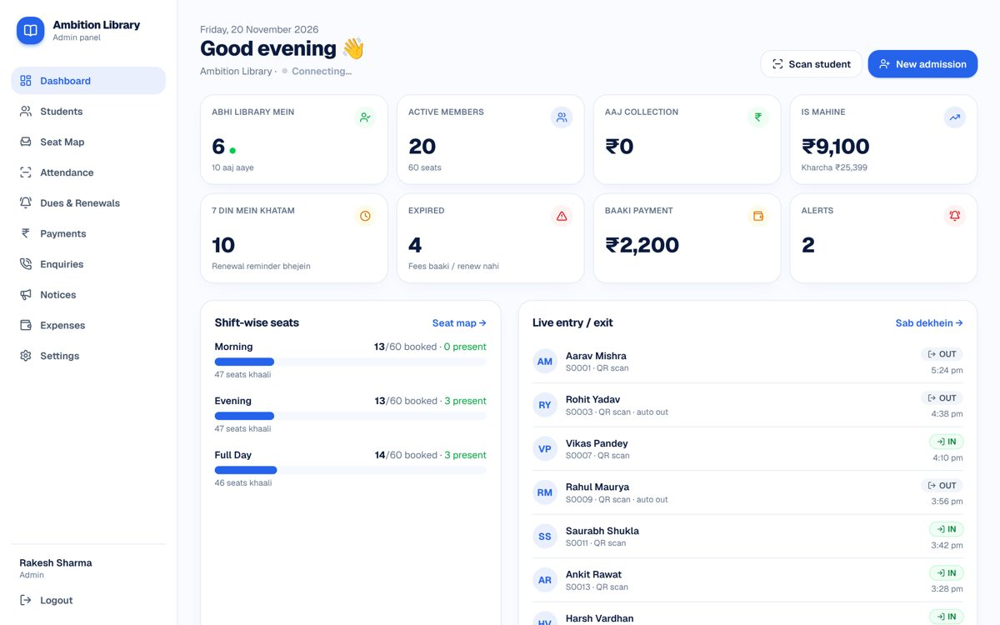
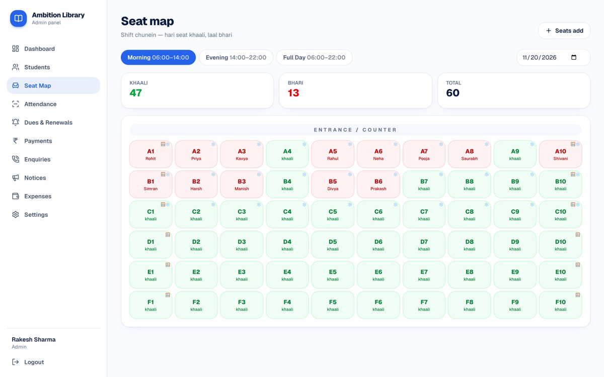
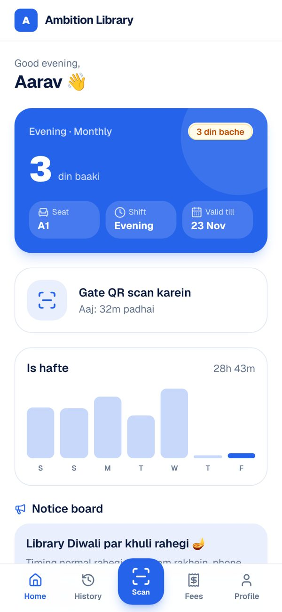
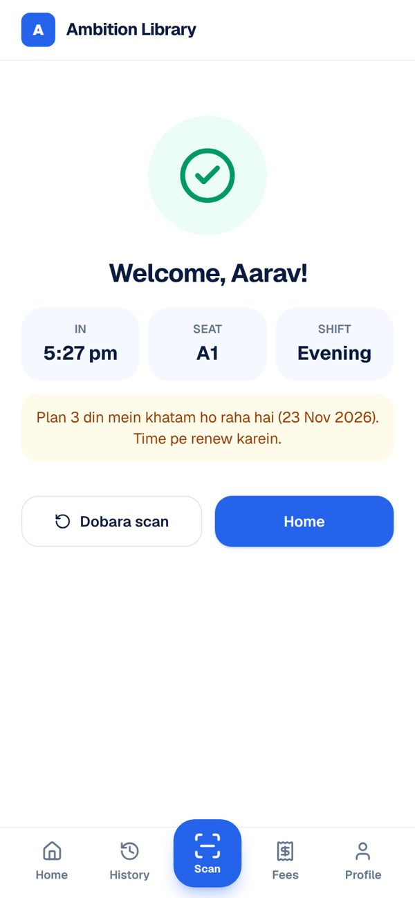

# Ambition Library — Library Management System

A complete system for a self-study library: **admissions, seat map, shift-wise booking, fees, receipts, dues reminders, QR attendance, student app (PWA), expenses and a live owner dashboard.**

Stack: **Next.js 15 + Tailwind v4 + Supabase** (Postgres, Auth, Storage, Realtime). Hosting: **Vercel Hobby + Supabase Free**, so you can start at ₹0.

| Owner dashboard | Seat map | Student app | Gate scan |
|---|---|---|---|
|  |  |  |  |

---

## Features

**Owner / Staff panel (`/admin`)**
- **Live dashboard**: how many people are in the library right now, today's collection, the month's profit, expiring/expired plans, pending fees and alerts. The page updates without a refresh (via Supabase Realtime).
- **New admission** in 3 steps: live photo + ID photo (only the last 4 digits of Aadhaar are stored, with consent) → plan + shift + seat + payment → a welcome message on WhatsApp with the login and receipt link.
- **Seat map**: a separate view for each shift. Morning and Evening students can share the same seat, while a Full Day student blocks the seat for the whole day. Double booking is blocked at the database level. Seats can be tagged (window, AC, charging).
- **Students**: search and filter, profile, renew, change seat, PIN reset, device reset, attendance history, payments.
- **Dues & renewals**: plans expiring within 7 days, expired plans, and students with pending fees. Each has a 1-click WhatsApp reminder (the message template can be changed in Settings).
- **Payments**: date range, cash/UPI totals, CSV export, a receipt link for every payment (`AL-00001`…).
- **Attendance**: list by day, live updates, CSV export, staff scanner (scans the student's personal QR), manual entry.
- **Enquiries, notices, expenses** (including the month's profit).
- **Settings**: library details, brand colour, logo, shifts, plans/pricing, geofence, gate QR, reminder template, staff accounts.

**Student app (`/app`, installable PWA)**
- Login with phone number + PIN.
- Plan card (days left, seat, shift), study hours (week and month), notice board.
- **Scan**: scanning the gate QR marks IN the first time and OUT the second time.
- Fees and receipts, "My QR" (fallback for staff to scan), change PIN.

**Attendance anti-cheat (everything is checked on the server)**
1. **Device binding**: the first scan locks that phone to the account, so scanning from a friend's phone won't work. If the student changes phones, the admin can "Reset device".
2. **Geofence**: a scan only counts when the phone is within ~150 m of the library, so scanning a screenshot of the QR from home doesn't work.
3. **Cooldown**: no double scans within 2 minutes.
4. **Shift check**: if someone comes outside their shift, the entry is flagged and the owner gets an alert.
5. **Expired plan**: entry is refused and the owner gets an alert.
6. **Auto OUT**: if someone forgets to scan OUT, they are checked out automatically 30 minutes after their shift ends (pg_cron).

---

## Setup (one client = one Supabase + one Vercel), about 20 minutes

### 1) Supabase project
1. Create a new project on [supabase.com](https://supabase.com). Region: **Mumbai (ap-south-1)**.
2. Go to **Database → Extensions** and enable **pg_cron**.
3. In the **SQL Editor**, paste and run these 3 files in this order:
   - `supabase/migrations/0001_schema.sql`
   - `supabase/migrations/0002_storage_cron.sql`
   - `supabase/migrations/0003_seed.sql` (default shifts, 60 seats, plans; you can change them later in Settings)
4. **Authentication → Sign In / Providers → Email**:
   - **Turn "Allow new users to sign up" OFF.** All accounts are created only from the admin panel.
   - Turn "Confirm email" OFF.
5. Copy the `URL`, `anon key` and `service_role key` from **Project Settings → API**.

### 2) Run locally (optional)
```bash
npm install
cp .env.example .env.local      # fill in the keys
npm run create-admin -- owner@email.com "StrongPass@123" "Owner Name"
npm run seed-demo               # optional: 12 demo students (PIN 1234)
npm run dev                     # http://localhost:3000
```

### 3) Deploy to Vercel
1. Push the code to GitHub, then in Vercel choose **New Project → Import**.
2. Add all 5 variables from `.env.example` under **Environment Variables**.
3. Deploy. For a custom domain, use Vercel → Domains (e.g. `app.ambitionlibrary.in`).
4. If you didn't run `create-admin` locally, put the live keys in `.env.local` and run it once.

### 4) First time at the library
1. The owner logs in at `/login` using the **Owner / Staff** tab.
2. **Settings → Library**: name, phone, UPI ID, logo, brand colour.
3. **Settings → Shifts / Plans**: set your timings and fees.
4. **Settings → Attendance & QR**: stand inside the library, tap **"Use my location"**, then Save.
5. Click **Print** to print the gate QR, laminate it and put it up at the entrance.
6. Students receive their login (phone + PIN) on WhatsApp at admission. Tell them: open the link → **Add to Home Screen** → use it like an app.

---

## Important notes
- **Students should always use the Scan button inside the app.** Opening the QR with the phone's normal camera also works, but on iPhone the browser and the installed app have separate storage, so a "device mismatch" can occur. If that happens, the admin can "Reset device".
- **To keep storage low**, photos are compressed before upload (~60–100 KB). The Supabase free tier (500 MB DB, 1 GB storage) is enough for 200 students: 200 students × 3 months of attendance ≈ 15–20 MB.
- **A free Supabase project pauses after 7 days of inactivity.** If the library uses it daily, this won't be a problem.
- **Backup**: Supabase → Database → Backups. On the free tier, it's a good idea to take a `pg_dump` once a month.
- **Vercel Hobby is for non-commercial use.** When a paying client comes in, move the frontend to **Cloudflare Pages** (free, commercial use allowed); the code stays the same.
- `SUPABASE_SERVICE_ROLE_KEY` is only used on the server (admin actions, receipt page). Never put it in client code.

## Tests
```bash
npm test            # 47 unit tests
npm run test:db     # 141 database tests (needs Postgres)
npm run test:e2e    # 70 browser tests (Postgres + Chrome)
```
Setup and details are in `tests/README.md`. Run `npm run test:all` after changing a migration or code.

## For a new client (another library)
Keep a single codebase. For each client: a new Supabase project + a new Vercel deploy + its env vars. Name, colour and logo are changed from Settings; no code changes needed.

## Folder structure
```
supabase/migrations/   SQL: tables, RLS, RPCs (scan_gate, staff_mark, seat_board, dashboard_stats…), storage, cron, seed
scripts/               create-admin.mjs, seed-demo.mjs
src/app/admin/         Owner/staff panel
src/app/app/           Student PWA (home, scan, history, fees, profile)
src/app/receipt/       Public receipt page (token link)
src/components/ui/     Buttons, cards, dialogs, tabs (shadcn-style)
public/                manifest, service worker, icons
```

---
Built by **ms.dev**
